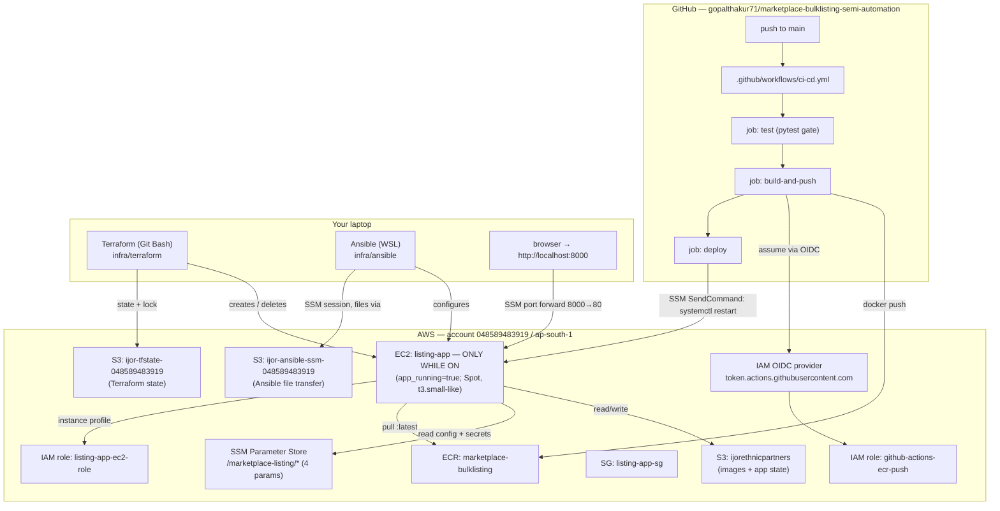

# Infrastructure Resource Map — AWS + GitHub

> Every cloud resource this project uses, how they connect, and **which file in code owns it**.
> Snapshot: **2026-11-17**. Account **`048589483919`**, region **`ap-south-1`** (Mumbai).
>
> **Since 2026-11-17 the code is the source of truth.** Every AWS resource below is managed by
> Terraform in [`infra/terraform/`](../infra/terraform/), and the server's setup is managed by
> Ansible in [`infra/ansible/`](../infra/ansible/). If this page and the code disagree, the
> code wins; `terraform plan` shows the real state.
>
> Day-to-day operation (turn the server on/off, open the app):
> [`runbooks/infra-terraform-ansible.md`](runbooks/infra-terraform-ansible.md). Why it's built
> this way: [`decisions/2026-11-17-terraform-ansible-disposable-server.md`](decisions/2026-11-17-terraform-ansible-disposable-server.md).
> Costs: [`infra-costs.md`](infra-costs.md).

## How it all fits together

---

## The server is disposable

The EC2 server **exists only while you're using it**. `terraform apply -var app_running=false`
deletes it, `true` builds a fresh one, and Ansible configures it in a few minutes. Nothing
lives on it: product images and the app's state are in S3, config and secrets are in SSM, and
the app image is in ECR. So deleting it loses nothing.

There is **no fixed instance ID**: every "on" creates a new one. Find the current one with
`terraform output instance_id`.

---

## AWS resources

### Compute & network
| Resource | Identifier | Owned by | Notes |
|---|---|---|---|
| EC2 launch template | `listing-app` | `infra/terraform/ec2.tf` (`aws_launch_template.server`) | Everything about the box except its type: AL2023 AMI, subnet + SG, instance profile, IMDSv2, 8 GB gp3, `Name=listing-app` tag. Permanent, free. |
| EC2 instance (via instant EC2 Fleet) | Tag `Name=listing-app` (new ID on every build) | `infra/terraform/ec2.tf` (`aws_ec2_fleet.server`) | **Spot only**, any type with 2 vCPU / 2–4 GB / burstable (AWS picks one with capacity: t3/t3a small/medium, t2.medium; `price-capacity-optimized`, `max_total_price` $0.0224/hr, terminated on interruption, never on-demand), Amazon Linux 2023, 8 GB encrypted gp3, IMDSv2 only, CPU credits `standard`. **No SSH key.** Created/deleted by `var.app_running`. Configured by Ansible. The CI deploy job finds it by the `listing-app` tag, so **exactly one instance may carry that tag**. |
| Security group | `sg-06ceeb9a898378bb0` (`listing-app-sg`) | `infra/terraform/network.tf` | **Zero inbound** (since phase 4/5): the app has no login, so the network must have no path in. Access is the SSM port forward only, and the container binds to `127.0.0.1:80` on the box. **Never add an ingress rule.** Outbound: all (ECR, SSM, S3). ⚠️ At import (2026-11-17) it also had `0.0.0.0/0` on 22 and 80; those were removed the same day. |
| ECR repository | `marketplace-bulklisting` | `infra/terraform/ecr.tf` | Tags `:latest` + `:<git-sha>`. Lifecycle: keep the last 3 images. Scan on push. |

### Identity (three separate roles, least privilege)
| IAM identity | Type | Policies | Owned by | Used by |
|---|---|---|---|---|
| `github-actions-ecr-push` | Role (OIDC, no keys) | inline `ecr-push` (push to the one ECR repo), inline `ssm-deploy` (`ec2:DescribeInstances`, `ssm:SendCommand` only to instances tagged `Name=listing-app` + `AWS-RunShellScript`, read command results) | `infra/terraform/iam.tf` | CI `build-and-push` + `deploy` jobs |
| OIDC provider | `token.actions.githubusercontent.com` | trust: `repo:gopalthakur71/marketplace-bulklisting-semi-automation:ref:refs/heads/main` only | `infra/terraform/iam.tf` | lets GitHub Actions assume the role above without stored keys |
| `listing-app-ec2-role` (+ instance profile of the same name) | Role (EC2) | `listing-app-runtime` (ECR pull; S3 `ListBucket` + `Get`/`Put` on `ijorethnicpartners`; SSM `GetParameter*` on `/marketplace-listing/*`) + AWS-managed `AmazonSSMManagedInstanceCore` | `infra/terraform/iam.tf` | the app on EC2; SSM agent (CI deploys, Ansible, port forwarding) |

> There is no `listing-app-s3` policy. Older diagrams showed one; it never existed in IAM.

### Configuration & secrets — SSM Parameter Store
| Key | Value / note | Owned by |
|---|---|---|
| `/marketplace-listing/s3_bucket` | `ijorethnicpartners` | `ssm.tf` |
| `/marketplace-listing/s3_prefix` | `myntra/` | `ssm.tf` |
| `/marketplace-listing/s3_region` | `ap-south-1` | `ssm.tf` |
| `/marketplace-listing/gemini_api_key` | **SecureString**. Terraform manages the parameter but **ignores its value**; the real value is set outside code and never appears in `.tf` files. Google Gemini key for the Fix flow's explanations. (Was missing from this page before 2026-11-17.) | `ssm.tf` |

The SecureString uses the free AWS-managed `aws/ssm` key. **No trailing whitespace in any
value**: a stray `\n` in an SSM value once broke login (`settings.py` now `.strip()`s values).
The 5 `cognito_*` parameters were deleted with Cognito in phase 5.

### Auth — none (Cognito removed, phase 5)
The app has no login. It's reachable only through an SSM port forward, so AWS IAM (the `gt`
profile that opens the session) is the gate; there is one user, the owner. The Cognito pool
`ap-south-1_NdxNQ1pIz`, its app client and the `ijor-marketplace` domain were deleted in two
applies (step A unlocked `deletion_protection`, step B deleted `infra/terraform/cognito.tf`).
Why: [`decisions/2026-11-17-remove-cognito-iam-only-access.md`](decisions/2026-11-17-remove-cognito-iam-only-access.md).

### Storage — S3
| Bucket | Purpose | Owned by | Notes |
|---|---|---|---|
| `ijorethnicpartners` | `myntra/…` product JPGs (**public read**: Myntra downloads them by URL); `state/myntra_groupid.json`, `state/hsn_kb.json`, `state/sku_registry.json` (**private**) | `infra/terraform/s3.tf` | `prevent_destroy` **permanently** on the bucket and its public-read policy. Terraform manages settings only, **never the objects**. Only `.jpg` uploads land under `myntra/`. |
| `ijor-tfstate-048589483919` | Terraform state (`listing-app/terraform.tfstate`) + its lock file | **by hand**, `infra/bootstrap-state-bucket.sh` | Versioned, encrypted, all public access blocked. The state contains the decrypted SecureStrings, so never copy it anywhere else. |
| `ijor-ansible-ssm-048589483919` | Scratch space for Ansible over SSM | `infra/terraform/ansible_transfer.tf` | Private; objects expire after 1 day. The box reads it through presigned URLs signed by your laptop, so the EC2 role has **no** grant on it. |

---

## GitHub resources
| Resource | Value |
|---|---|
| Repository | `gopalthakur71/marketplace-bulklisting-semi-automation` (default branch `main`) |
| Workflow | `.github/workflows/ci-cd.yml`: `test` → `build-and-push` → `deploy`. Runs on push to `main`; PRs run `test` only. |
| Repo secret | `AWS_ACCOUNT_ID` = `048589483919` (an account number, **not a credential**; OIDC provides short-lived creds) |

**While the server is off, the `deploy` job fails.** There's no instance tagged `listing-app`
to restart. That's harmless: the image is already in ECR, and the next "on" pulls `:latest`.

---

## Not provisioned (deliberately)
- **TLS + a public URL.** The app is reached only through an SSM port forward to
  `localhost:8000`; nothing is exposed to the internet.
- **An Elastic IP or a fixed instance.** The server is rebuilt on demand.
- **Terraform in CI.** It's applied from the laptop; a `plan`-on-PR job can come later.
